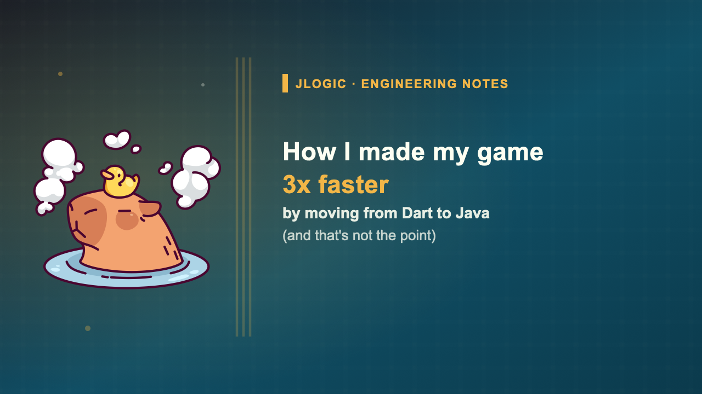
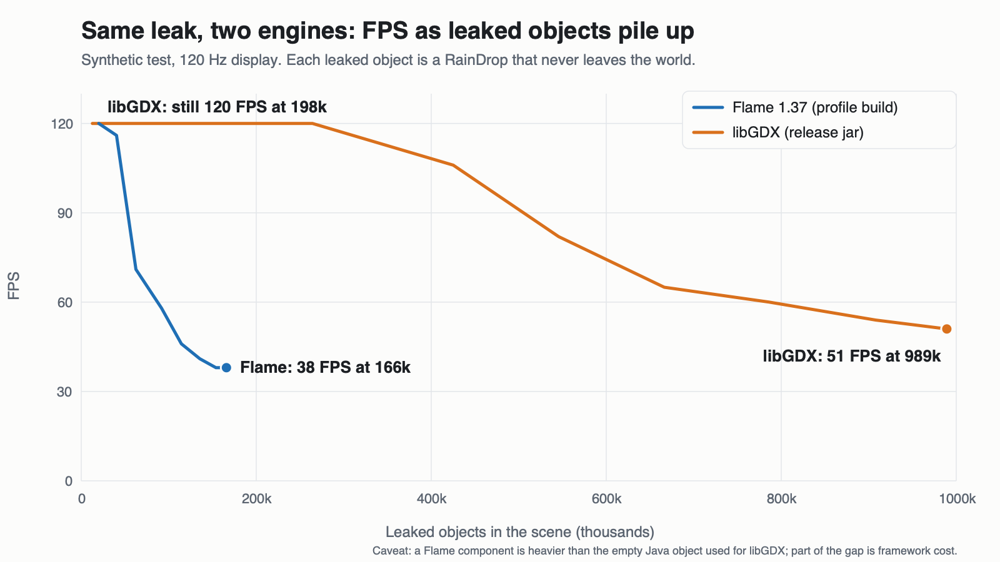

# How I made my game 3x faster by moving from Dart to Java (but that's not the point)

<figure class="article-cover">
  
  <figcaption>Illustration: capybara element by upklyak — Magnific.com</figcaption>
</figure>

Quick spoiler so the haters don't have to invent one: Flame had nothing to do with it. I wrote the memory leak myself, and I switched engines because of it. If you came for a "Flame is bad" story, this isn't it. This is a story about how easy it is to blame someone else for your own mistake.

A capybara is friends with everyone. Birds sit on it, monkeys sit on it, caimans stroll right past. It doesn't chase anyone away, doesn't warn anyone about anything, and never hurries. Remember that, we'll come back to it.

## 1994: Quick Basic and I was 11

In 1994 I made a game. In Quick Basic, on MS-DOS, with whatever was available back then: a handful of colors, sound from the PC speaker, no shadows, no particles. *Edgard in Kimeria*. Nothing special, I was 11 years old. But I loved it.

Thirty-some years later I decided to rebuild it. Not a copy, a remaster, a modern take: pixel art with living light, torches and rain made of particles, modern shaders, lots of enemies and traps, interactive events. Everything I wished I could have on Quick Basic.

I picked Flutter and Flame. I know Flutter, I like Dart, and Flame is the game engine for Flutter. What could possibly go wrong?

## At first everything flew

I built a prototype with two levels: a player, a couple of monsters, platforms and jumping. It ran at 120 FPS. I was pleased with myself.

Then I started adding the juicy stuff: torches made of particles, parallax, more monsters, more shaders, more of everything. And at some point I noticed the game had become about three times slower. I took no measurements, but that was exactly the feeling: "Seriously? It's this slow already?"

I went to the internet. The answer was waiting there, fully cooked: full-screen shaders, layer repaints, the garbage collector, Flame is not really an engine but a layer over a UI framework. I asked an AI, and it agreed with the internet. I also remembered a talk from the Flutter team about their game DashLander (landing a module on an asteroid, with shaders and particles): they said themselves that they were not building a high-performance, real-time game ([talk, 10:30](https://www.youtube.com/watch?v=UNdQhnpm8GY&t=630s)). Granted, they were talking about dropping multiplayer, not about Flame's limits. But back then it felt like everything added up.

## I did not profile

Why not? My reasoning went like this: if it already crawls with ten monsters and ten torches, what happens on a long level with even more detail? Better to switch engines now than to port a finished game later. That's what I thought back then.

I trusted my feelings over numbers. I did not profile.

> "Measure. Don't tune for speed until you've measured"
> — Rob Pike, Rule 2, [Notes on Programming in C](https://www.cs.princeton.edu/courses/archive/spr01/cs217/pike.html)

Twenty-plus years in a profession where reviewing other people's code was my daily bread, and here I am, trusting my gut on my own project. An architect's intuition can't be wrong. Can it?! ...Right? ...*Right?*

Overconfidence was my undoing.

## Better the old workhorse than two shiny new ones

I rewrote it in Java. The one I know and understand. It's over thirty years old, it has half a dozen garbage collectors, and it is predictable even with all of them. Along the way I learned two things: I know Dart worse than Java, and understanding Flutter does not mean writing a stable 120 FPS game in Flame.

I took libGDX and moved over the same assets, the same maps, the same shaders. On the same scene I got a steady frame rate. The game became about three times faster. By feel, since once again I had no measurements. I exhaled and never looked back.

## And then I stopped and ran a retrospective

I decided to write about the move. To avoid lying, I went back to Flame and ran the current version of the game. And it surprised me: that "about three times slower" I could not reproduce in lab tests. On my Mac (a 120 Hz display) the game held 120 FPS in both debug and profile mode on the real levels, with every shader. Flame has grown many versions since then, and even Flutter has swapped its rendering engine. Maybe that's the reason, maybe it's something else.

So the first hypothesis went into the bin:

- **Hypothesis 1:** full-screen shaders and the garbage collector are slowing the game down.
- **Measurement:** both real levels, debug and profile builds, every shader on: 120 FPS.
- **Result:** rejected. I was off by an entire category.

But I couldn't leave it alone. I played for about five minutes and saw the frame rate start to drop. Not as dramatically as the first time, but it dropped, and **over time**.

And then it hit me: rendering does not get tired. If things get worse with time, it's memory. And memory that keeps disappearing means a leak. Thanks, Captain Obvious. (Yes, I rolled my eyes at that point too.)

## How I hunted for guests

What do you count? I took the game and, every 30 seconds, printed how many components of each type were in the world:

```dart
final w = camera.world;
print(w?.descendants()
    .map((c) => c.runtimeType.toString())
    .fold<Map<String, int>>({}, (m, t) { m[t] = (m[t] ?? 0) + 1; return m; }));
```

One player, one torch, some platforms, some enemies: every number stood still. Except one: `RainDrop`. After 30 seconds there were 1,200 of them. After 60 seconds, 2,677. After 90 seconds, 4,168. That's about 50 more every second, and it was growing like yeast.

- **Hypothesis 2:** something is leaking.
- **Measurement:** component counts by type, every 30 seconds.
- **Result:** confirmed. Only the raindrops grow.

Next I had to find out why. Here is my own rain code, as it was:

```dart
Future.delayed(Duration(milliseconds: (duration * 1000).toInt()), () {
  if (parent != null) {
    (parent as Component).add(RainDrop(area: area)); // a new drop
  }                                                  // and the old one?..
});
```

Every drop, after landing, creates a new one. And never removes itself. The old drop stays in the world as an empty lump. A "guest" who arrived and never left.

And here is the important part: back then there was no automatic pool and no automatic object reuse. The library did not stop me from shooting myself in the foot: the rake was just lying there, and I stepped on it. And creating an object without `new` is convenient, sure, but only up to a point. More on that later.

## An hour-long experiment, without the hour

Now I had to check whether those guests really kill the frame rate. For that I would have to wait an hour. And I did not want to wait an hour. So I built a synthetic test: a purpose-built load instead of a live game. I sped up the falling drops by a factor of 100, so they landed and bred guests a hundred times faster. 26 seconds of test equals roughly 43 minutes of play:

```dart
final speed = (400.0 + _rand.nextDouble() * 80.0) * boost; // boost = 100
```

The speed-up is artificial, of course, but that is the whole point of a synthetic test: turning hours into seconds. And a second run alongside it, with one line added at the end of the callback:

```dart
Future.delayed(Duration(milliseconds: (duration * 1000).toInt()), () {
  if (parent != null) {
    (parent as Component).add(RainDrop(area: area));
    removeFromParent(); // the old drop leaves, the new one arrives
  }
});
```

Here is the result:



In plain numbers: at 20k leaked objects both engines run at 120 FPS. At 62k Flame is at 71, libGDX still at 120. At 166k Flame is at 38, libGDX at 120.

200,000 extra objects in libGDX? Easy! Here are your 120 frames per second, I'm not even out of breath. And Flame at 166,000? You get 38 frames, and don't cry. But in fairness: libGDX has a limit too, and a million guests drag even it down to 51. Also, my "guest" in libGDX is a light Java object with an empty method, while a Flame component is heavier: a tree of children, a lifecycle, properties. Part of the gap is exactly that, the price of a framework, and not only JVM magic.

With `removeFromParent()`, Flame held 120 FPS the whole time, and the number of guests stayed exactly where it should (97, not a hundred and sixty thousand).

- **Hypothesis 3:** the leak is what kills the frame rate.
- **Measurement:** the synthetic test, with and without the one-line fix.
- **Result:** confirmed. Flame holds 120 FPS until about 60,000 leaked objects, then falls.

**What this does not explain.** At the real rate of about 50 guests per second, 60,000 objects take roughly 20 minutes to pile up. My own drop came after about five. So the leak is real, proven, and cured by one line, but it doesn't fully account for what I saw. Something else may have been going on back then, or my machine simply had less headroom, and I never managed to reproduce the original slowdown. I'm telling you what I measured, not what I'd like to have measured.

## Why one line, and not a pool?

A fair question. Flame has a `ComponentPool` for exactly this kind of thing, and it suits rain perfectly. But a component returns to the pool at the moment of `removeFromParent()`. Without that call the pool does not work at all. A pool is a seat belt, and I forgot to open the door. First you have to stop collecting guests.

The library is not to blame. It tolerated all the guests and quietly slowed down. I told you: capybara.

## But why did I stay on Java anyway

If it all came down to "I forgot one line", there would be no article. But I did not just forget a line. I did not **see** it.

Here is the same drop in libGDX:

```java
public void update(float dt) {
    elapsed += dt;
    if (elapsed >= duration) {
        startRain();   // reset itself and fall again, no new objects
    }
}
```

In Java every guest has to announce itself: `new RainDrop(...)`. Creating an object is visible to the eye and findable with a search. That is why my libGDX version has two watchmen. The first, a script, looks at the changed lines in hot methods (`update`, `render`, `draw`) and complains about `new`, about calls with a variable number of arguments, about `for-each` loops over lists and about building strings. The second, a test called `AllocationBudgetTest`, measures the real bytes the game allocates per frame through `ThreadMXBean`. The script honestly admits it is only a net for new code, and only the test proves a path is clean.

In Dart the word `new` was removed, and there are reasons for that. [Effective Dart](https://dart.dev/effective-dart/usage#dont-use-new) says it outright: its meaning is unclear, because factory constructors may return an object that is not new. So in Dart `new` does not promise a new object, and `RainDrop(area: area)` looks like an ordinary function call. You can't see the leak until the game starts to slow down. And a watchman that catches extra object creation by spotting the word `new` is impossible to write.

It's not only syntax. There is also a safety margin. In libGDX, pools, mutable vectors and the rule "zero allocations in the loop" have been there from the start, and its wiki ties pools directly to the garbage collector. In Flame, `ComponentPool` only appeared in version 1.36 and automatic batching in 1.37, and the performance page of the docs is silent about full-screen shaders, about batching, and about the garbage collector.

The capybara does not warn you. It has found its zen and is in no hurry.

## What it cost me

Here is the part that, like cold start in the last article, did not get better. The numbers acquitted Flame, and I still did not go back. Same principle, calculate don't guess, and an answer I didn't expect.

So here is the bill for staying:

- Flutter's hot reload is gone. I had to build a poor man's version (`runDev`) that polls the sources every second, redefines classes on the fly and falls back to a full restart when the JVM refuses.
- The web build was a fight. The official Gradle plugin for libGDX's browser backend turned out to be unmaintained since 2022 and fails on modern Gradle, so I moved to TeaVM, which is less battle-tested.
- The menus are hand-drawn. I skipped Scene2D to avoid dragging in a whole skin for a handful of screens, and now every button is mine to maintain.

None of this shows up in a frame-rate chart. It is just the price of choosing the tool where my mistakes are visible.

## What people who know this stuff say

I'm not the only one. I've watched Filip Hráček's videos since he was a Flutter Developer Advocate at Google ([that's how a 2020 GDG event billed him](https://gdg.community.dev/events/details/google-gdg-capital-region-presents-online-flutter-with-filip-hracek-flutter-developer-advocate-google/)), and I kept watching after he [left Google in September 2021](https://x.com/filiphracek/status/1436313678782009347). He's the author of the book [UI Performance](https://filiph.net/flutter-performance/), takes on performance problems in Flutter apps, and is building his own game, Giant Robot Game, in Flame. He had to [write his own 3D renderer](https://filiph.net/text/making-my-1970s-renderer-multi-threaded.html), move it to a separate isolate and reuse buffers so as not to disturb the garbage collector.

As I understand from YouTube, he says Dart is the language he knows best, and that building infrastructure in it costs him less than switching stacks. He chose to keep extending Flame. My situation is the opposite: I know several languages well enough, and I have no loyalty to Dart, so sometimes it is simply easier for me to switch stacks.

## Conclusion

- If your FPS drops over time, it is not the renderer. It is memory.
- Numbers beat feelings. I switched engines because of a hypothesis I never checked, and I almost wrote a "why Flame is bad" article.
- A good library is not faster. It just forgives more.
- If the internet and an AI confirm your diagnosis, that is not yet a reason to believe it: maybe you should dig deeper and check the diagnosis.
- The AI agreed with the internet in seconds. It was also the one that did the tedious counting and built the synthetic test. Which hypothesis was worth testing, and whether the numbers meant what they seemed to mean, I still had to decide myself, reading every diff.
- Twenty-plus years, an engineering master's degree and a stint as an architect did not stop me from skipping the profiler. What experience bought me was knowing *where* to count once I finally did.
- I choose a tool where my mistake is visible, not merely forgiven.

The capybara is not to blame. It is just too kind.
